# ICS Digital Twin: User Flows

**Date:** 2026-10-18. **Scope:** read-only source analysis and proposed design documentation. No application interactions were executed and no behavior below has been implemented by this audit.

Companion: [UI/UX proposal](UIUX_REDESIGN_PROPOSAL.md), including WF-01 through WF-15 and backlog UX-001 through UX-028. [Master brief](UIUX_MASTER_PROMPT.md).

> **Follow-up 2026-10-19:** The original F01–F12 below are preserved source-only records. The later Figma-F01–Figma-F04 addendum records the narrowed Overview / Floor 1 / Floor 2 scope, actual editable diagrams and subsequent browser evidence. Old counts reflect the earlier snapshot. No business-state actions were exercised.

## Reading Guide

- **Current:** verified from working-tree source, not observed in a browser. A bug shown in a current branch is not a recommended outcome.
- **Conditional current:** code exists but is not active with the present configuration, notably credential login while demo bypass is enabled.
- **Proposed:** node/transition prefixed `Proposed` or explained separately; requires future authorization. Mermaid shapes do not imply deployed functionality.
- A rectangle is an action/system response; diamond is a decision; rounded entry/exit is a journey boundary. Arrows describe the named variant only. All diagrams are low-fidelity flowcharts, not interface renders.
- Roles are Admin and Viewer only. Client permission checks are a demo boundary, not production security. Data is local simulated/static data, not live sensors. No manual incident Resolve, work-order approval, billing payment, tenant access, or integrated 3D control is assumed.
- Cross-cutting future error/loading/keyboard contracts are UX-016/UX-019/UX-022/UX-023. A retry is not shown as an existing network operation where only synchronous mock data exists.

## F01. Entry, Role Preview, Credential Variant, and Exit

**Entry:** `/`, `/login`, or protected deep link. **Users:** both roles. **Wireframes:** WF-01/WF-14. **Recommendations:** UX-001/UX-021/UX-024/UX-025.

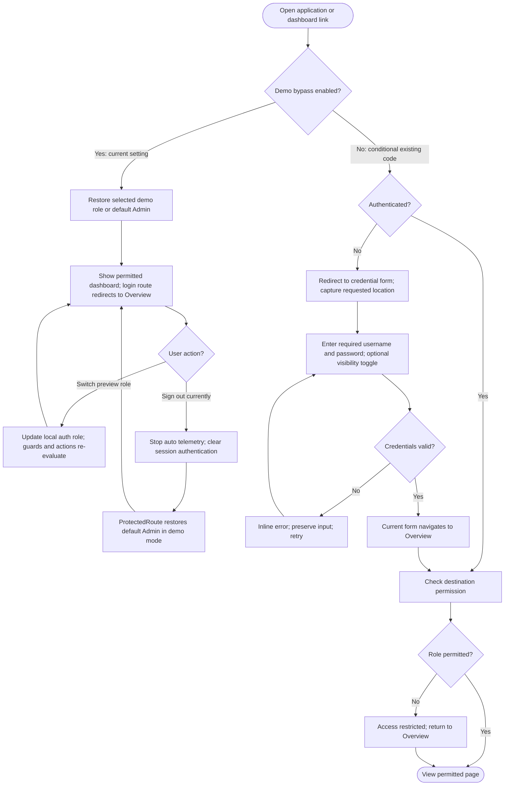

**Current caveat:** Sign out does not leave a durable signed-out screen in demo mode. Credential success does not consume the captured deep-link destination. The demo switcher is not an approval or real authorization service.

**Proposed recovery:** define honest demo-exit behavior/copy; keep credential mode separate. A future credential-return enhancement validates an internal existing route and role before navigation; denied/invalid targets recover to Overview. Product must approve the demo-exit destination before development. No auth flag or account state was changed in this audit.

**Evidence:** `src/app/router.tsx:19-37`; `src/features/auth/demoRoleMode.ts:16-17`; `authStore.ts:28-81`; `ProtectedRoute.tsx:12-20`; `LoginPage.tsx:28-52`; `DashboardHeader.tsx:69-72`; `DemoRoleSwitcher.tsx:19-22`.

## F02. Building/Floor Scope and Context-safe Navigation

**Entry:** any dashboard scope selector or scoped link. **Users:** both roles. **Wireframes:** WF-02/WF-03/WF-04/WF-13. **Recommendations:** UX-002/UX-003/UX-004/UX-024.

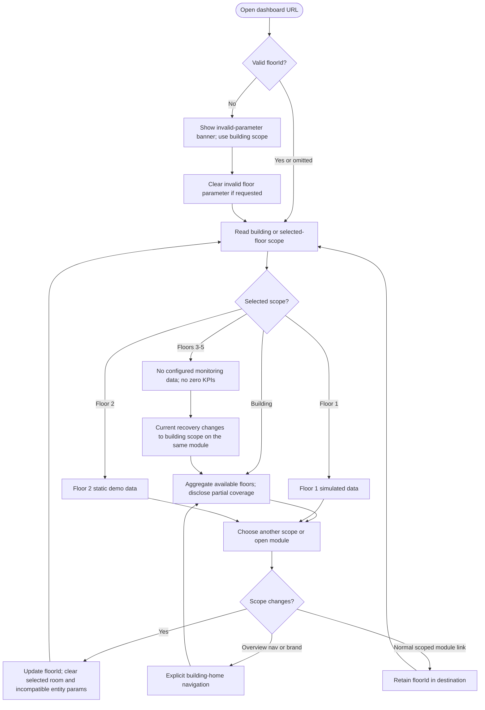

**Known current exceptions:** header incident/asset links omit floor scope; Environment clear-room removes all query parameters. See F06/F08. The no-data recovery label promises Overview even if route remains Energy or another module.

**Proposed:** retain the normal URL model, make all drill-down links context-safe, label scope-only recovery accurately, and make picker keyboard/touch behavior coherent. Do not remove unavailable floors or silently substitute Floor 1 data.

**Evidence:** `DashboardLayout.tsx:47-65,132-161,228-239`; `DashboardScopeBoundary.tsx:14-31`; `FloorNoDataState.tsx:34-38`; `navigationConfig.ts:47-152`; `scopedPath.ts:3-13`.

## F03. Overview Date and Range Investigation

**Entry:** building/floor Overview date control. **Users:** both roles. **Wireframes:** WF-02/WF-03/WF-04/WF-05. **Recommendations:** UX-008/UX-009/UX-024.

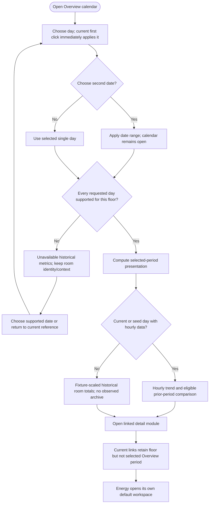

**Current constraints:** Floor 1 supports local today/yesterday plus demo seed dates 2026-10-08/07; Floor 2 supports only those two seed dates. A range requires every day to be supported. Some historical values are scaled from current totals to a fixture total, not archived measurements. Calendar month navigation permits unsupported/future selections; Escape/outside close does not roll back immediately applied selection. The implementation has a 366-day enumeration cap. Energy currently has hourly/cumulative and yesterday-comparison controls, **not an independent calendar**.

**Proposed:** explicitly show supported dates and reconstructed-data status; consider a draft selection with Apply/Cancel rather than implicit first/second-click application; carry valid intended period to drill-down or disclose its reset. All such changes are UX-008/UX-024 and do not require fabricating historical data. Unsupported dates recover to a known supported reference.

**Evidence:** `src/features/dashboard/dateFilterUtils.ts:7-8,66-85,101-173,194-233`; `OverviewDateFilter.tsx:112-134,152-191,284-301`; `DashboardPage.tsx:89-100`; `BuildingOverviewPage.tsx:49-52`; `EnergyPage.tsx:61-81`.

## F04. Floor/Room Investigation and Local Controls

**Entry:** Floor 1 or Floor 2 room map/directory. **Users:** both roles. **Wireframes:** WF-03/WF-04/WF-07. **Recommendations:** UX-002/UX-007/UX-011/UX-016/UX-027.

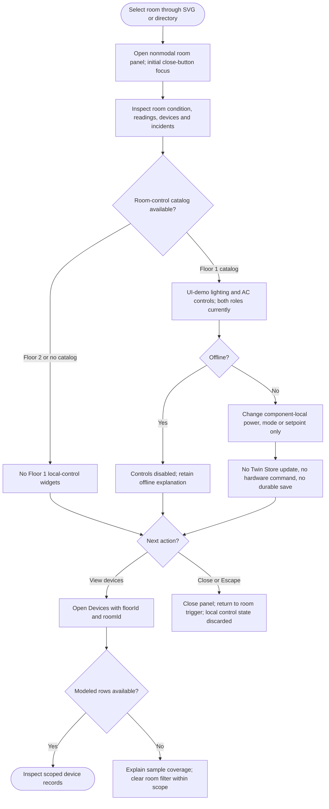

**Proposed:** retain a nonmodal panel and equivalent keyboard room directory; focus changes once on open, not on every telemetry-driven room object replacement. Viewer should have read-only device-preview presentation using existing control-permission meaning; Admin preview must explicitly explain local/reset-on-close semantics and off/offline/range/mode behavior. No real device control integration is proposed. Threshold labels must match the actual classifier, not hard-coded alternative limits.

**Evidence:** `Floor1MapPanel.tsx:147-157`; `RoomDetailDrawer.tsx:267-355,387-406,531-685`; `DevicesPage.tsx:28-65`.

## F05. Energy Consumption, Comparison, and Forecast

**Entry:** Energy navigation or Overview energy KPI. **Users:** both roles. **Wireframe:** WF-05. **Recommendations:** UX-008/UX-009/UX-010/UX-012/UX-022.

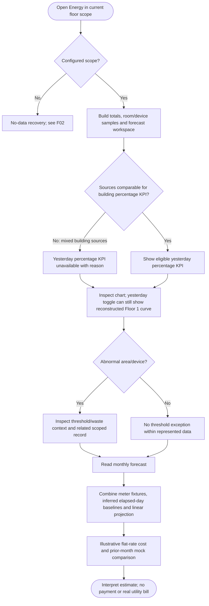

**Current caveats:** building daily KPI can sum Floor 1 current plus Floor 2 older sample, although the building chart is Floor-1-only and the comparison percentage KPI is correctly unavailable. The chart comparison toggle remains enabled and can still render a reconstructed/scaled Floor 1 yesterday curve; that is not an observed building comparator. A lazy-chart Suspense fallback already exists; not all chart loading is absent. Forecast baseline-filled quantities are not recorded actuals. Repeated hourly-spike scenarios can increase room totals again while replacing the same fixed chart curve, causing further divergence.

**Proposed:** a floor/date/source ledger determines headline eligibility; comparable same-period totals reconcile across modules and repeated scenarios. Chart title/axes/cutoff distinguish cumulative, interval and estimated data with a text equivalent. Monthly forecast names its independent period, observed vs baseline-filled vs projected contributions, formula and tariff exclusions. Missing inputs show unavailable, not zero or a bill. No new billing data/service is assumed.

**Evidence:** `EnergyPage.tsx:38,61-105,137-205,207-280`; `energyWorkspaceModel.ts:192-209,296-328,409-427,568-588`; `energyForecast.ts:55-76`; `EnergyForecastCard.tsx:41,60-64,84-88`; `twinStore.ts:573-599`.

## F06. Environmental Exception and Missing-data Recovery

**Entry:** Environment navigation or room-focused link. **Users:** both roles. **Wireframe:** WF-06. **Recommendations:** UX-002/UX-011/UX-022/UX-024.

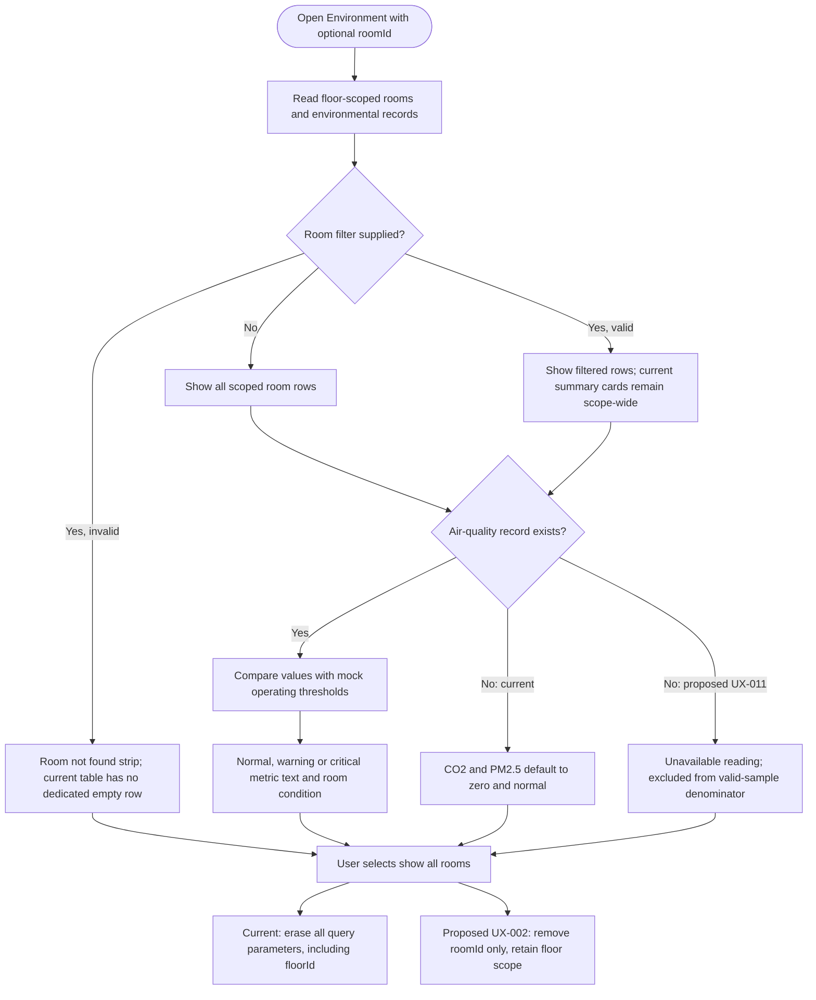

**Proposed continuation:** provide contextual Devices/Incidents links only where matching entities exist; describe operating vs critical thresholds consistently across Environment and room panel. Missing/offline/last-known/normal must remain separate. Do not invent regulatory certification or measurements. Scope-wide summary cards above room-filtered rows require explicit denominator/context.

**Evidence:** `EnvironmentPage.tsx:21-47,58-101`; `environmentSelectors.ts:14-30`; `floor1Environment.mock.ts:3-12`; `RoomDetailDrawer.tsx:387-406`.

## F07. Modeled Device Inspection and Filter Recovery

**Entry:** Devices navigation, targeted device, or room-panel drill-down. **Users:** both roles. **Wireframe:** WF-07. **Recommendations:** UX-012/UX-019/UX-024.

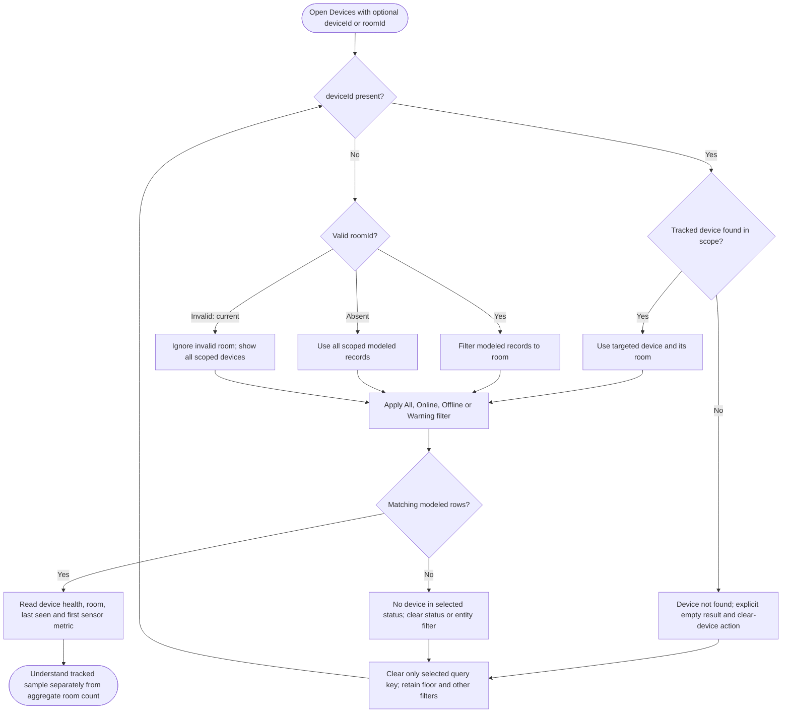

**Current caveats:** Online means normal status, while Warning includes warning+critical; a warning device may still be connected. Primary sensor unavailable/offline can say disconnected while device status says Online because these refer to different entities. Rows have no implemented standalone device-detail page. No search, sort, export or pagination is rendered here.

**Proposed:** invalid room gets explicit scoped no-match recovery instead of silently broadening; nearby count labels separate aggregate/filtered/tracked samples, connectivity and health. Use supported asset/incident links, not an invented device-detail route. Additional sorting/pagination remains conditional on actual inventory scale.

**Evidence:** `DevicesPage.tsx:28-65,76-102,111-148`; `deviceSelectors.ts:4-27`.

## F08. Incident Triage and Acknowledgement

**Entry:** attention queue, header preview, or Incidents page. **Users:** Admin/Viewer. **Wireframe:** WF-08. **Recommendations:** UX-002/UX-013/UX-016/UX-023.

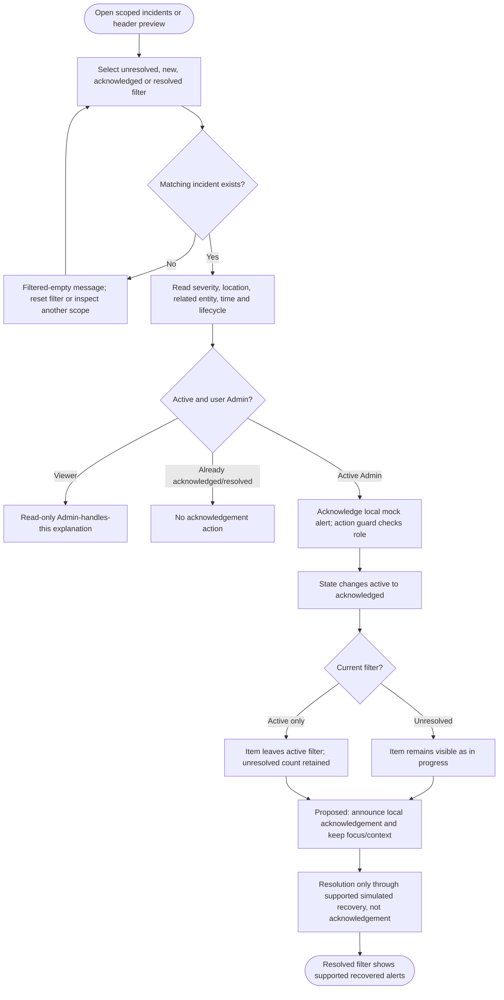

**Current caveats:** newest-first page order differs from priority-first header order. Header routes can lose floor context. Recovery is incident-type-specific: modeled temperature/air-quality paths can resolve; the global Return System To Normal scenario resolves all initial alerts and also normalizes Floor 2. Maintenance recording does not itself resolve related alerts. There is no manual Resolve action.

**Proposed:** one explained priority/lifecycle vocabulary, scoped item links and native independent actions. Acknowledgement feedback explicitly says local and not resolved/durably dispatched; failed/denied operations leave the item visible with reason. No new permission, assignment or escalation workflow is assumed.

**Evidence:** `IncidentsPage.tsx:17-27,36-59,83-170`; `alertSelectors.ts:6-17`; `IncidentsPopover.tsx:109-138,214-280,294-301`; `twinStore.ts:339-346,395-414,494-504,604-605`.

## F09. Asset Maintenance Recording and Result-aware Proposal

**Entry:** Assets > Maintenance plans > Record. **Users:** Viewer reads; Admin records locally. **Wireframe:** WF-09. **Recommendations:** UX-014/UX-015/UX-016/UX-024.

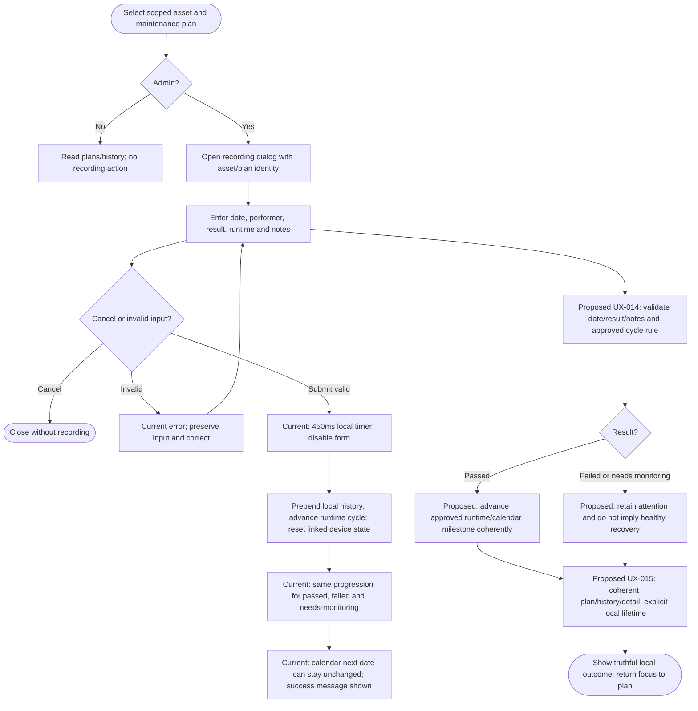

**Current failure risks:** optional blank notes generate a stable-after-maintenance narrative even for failed results. Runtime plausibility/future-date prevention is weak. Plan/history state is component-local; navigating away can discard records while linked Twin device state remains changed. Drawer reads independent initial/hard-coded plans/history. No backend save/failure branch or work-order completion is implemented.

**Assumption requiring approval:** specific recurrence rules for passed vs failed vs needs-monitoring and date/runtime validity. The proposed branch deliberately does not invent a work-order/incident-resolution lifecycle. In any future real persistence integration, failed save must preserve form input and not update success state before confirmation.

**Evidence:** `AssetsPage.tsx:60-100,300-414,1326-1504`; `maintenanceData.ts:275-282,340-343`; `assetDetailSelectors.ts:461-491`.

## F10. Asset Identity, Detail, Plans, and History

**Entry:** Assets list, Overview exception, or maintenance-related incident link. **Users:** both roles. **Wireframe:** WF-09. **Recommendations:** UX-002/UX-015/UX-016/UX-024/UX-026.

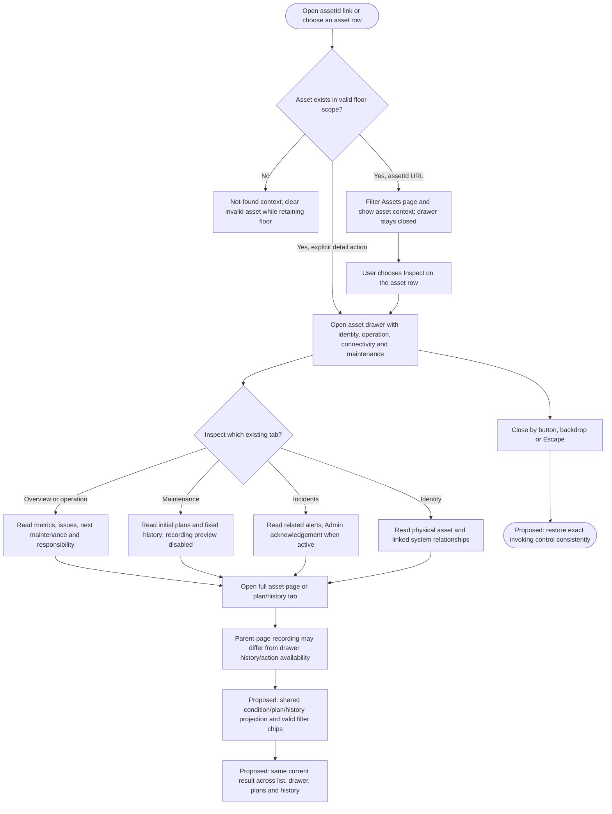

**Current caveats:** a normal asset can be mapped to warning and gain a sensor-check attention message. Related historical/resolved alerts can appear in a block called open issues. Focus restoration is implemented by the drawer but not all callers supply the trigger reference; focus may reset on callback/item rerenders. Existing tabs are five detail categories, not five new routes.

**Proposed:** accurate status/reason mapping; distinguish unresolved versus historical issues; synchronize plan/history and recording capability; explicitly choose modal containment vs docked nonmodal behavior. URL asset restriction and local filters must be visible and recoverable after scope changes.

**Evidence:** `AssetsPage.tsx:91-100,118-129,193-195,226-228,256-297,1509-1518`; `AssetDetailDrawer.tsx:79-98,126-303,699-750`; `assetDetailSelectors.ts:317-322,426-429,461-491`; `AssetExceptionsSection.tsx:164-176`.

## F11. Simulation, Role Boundaries, and Reset

**Entry:** Floor 1 Overview simulation controls or Admin Settings. **Users:** Admin mutates; Viewer reads current state. **Wireframes:** WF-03/WF-11/WF-14. **Recommendations:** UX-006/UX-008/UX-013/UX-025/UX-027.

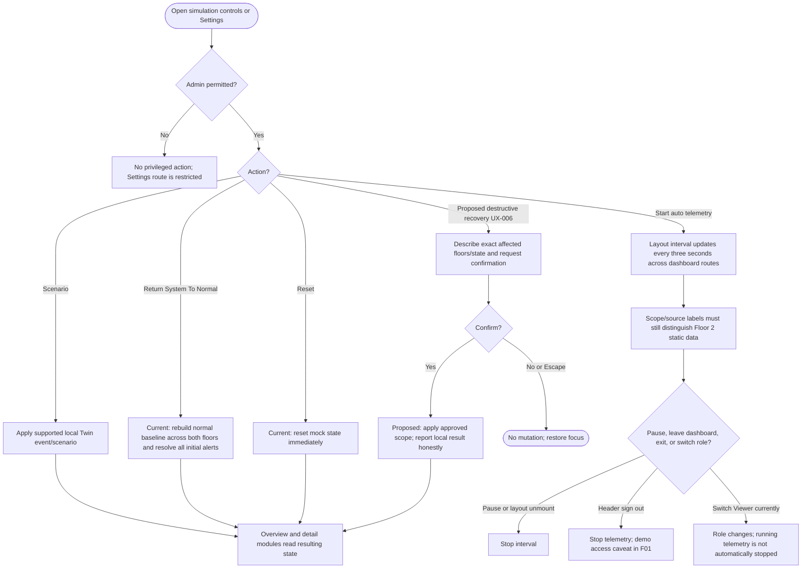

**Important source distinction:** auto telemetry updates Floor 1; the current global normalization path modifies both Floor 1 and Floor 2, despite controls being presented in Floor 1 context. The proposal recommends explicit scope-safe behavior, not a false assertion that current Floor 2 can never change. Repeated energy-spike action must reconcile totals and fixed chart replacement (UX-008).

**Assumptions requiring approval:** should ongoing simulation continue or pause on a switch to Viewer; should normalization remain global or become Floor-1-only; what exact state reset covers across component-local maintenance and Twin Store. Whatever is chosen must match labels, confirmation, permissions and data provenance. No real hardware/API action is proposed.

**Evidence:** `SettingsPage.tsx:19-40,69-97`; `DashboardLayout.tsx:67-71`; `DemoRoleSwitcher.tsx:19-22`; `twinStore.ts:110-142,573-605`; `DashboardHeader.tsx:69-72`.

## F12. Planned Module, Denied Route, and Unknown Address Recovery

**Entry:** 3D navigation, a denied Settings link, or unknown URL. **Users:** both roles/unauthenticated conditional credential mode. **Wireframes:** WF-12/WF-13/WF-14/WF-15. **Recommendations:** UX-004/UX-017/UX-021/UX-022/UX-023/UX-024.

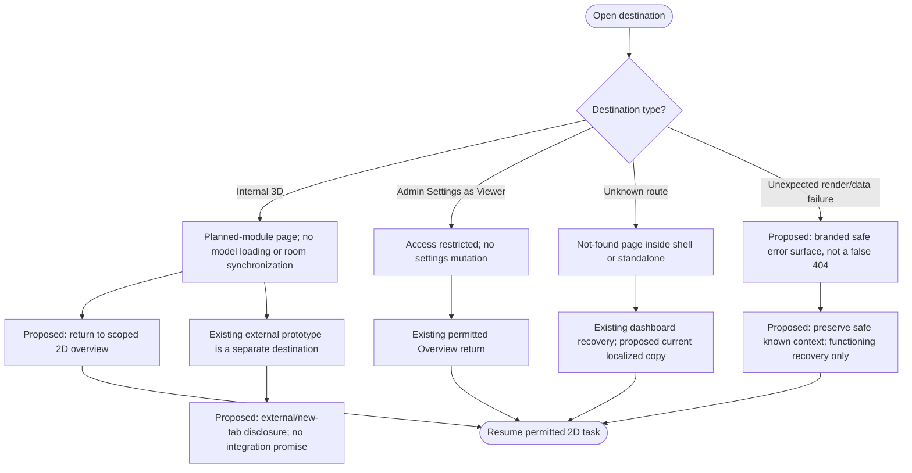

**Proposed safety:** separate planned/unconfigured/denied/not-found/unexpected-error states. Never show unknown floors as healthy, automatically escalate permissions, dump exceptions/private data, or claim an untested external service is online. Keep one main landmark in the shell, focus the recovery heading, and validate any optional previous-page return. There is no proposed account-approval workflow or 3D implementation.

**Evidence:** `src/app/router.tsx:63-79`; `ModulePlaceholderPage.tsx:14-39`; `PermissionGuard.tsx:18-40`; `NotFoundPage.tsx:3-10`; `PhasePlaceholder.tsx:18-59`; `DashboardPage.tsx:271-273`.

## Review and Traceability

- F01: WF-01/WF-14; access and safe return, UX-001/UX-021/UX-024/UX-025.
- F02: WF-02/WF-03/WF-04/WF-13; scope and recovery, UX-002/UX-003/UX-004/UX-024.
- F03: WF-02/WF-03/WF-04/WF-05; date semantics, UX-008/UX-009/UX-024.
- F04: WF-03/WF-04/WF-07; room investigation/local preview, UX-002/UX-007/UX-011/UX-016/UX-027.
- F05: WF-05; energy and forecast, UX-008/UX-009/UX-010/UX-012/UX-022.
- F06: WF-06; environment and missing data, UX-002/UX-011/UX-022/UX-024.
- F07: WF-07; device sample/filter recovery, UX-012/UX-019/UX-024.
- F08: WF-08; incident lifecycle, UX-002/UX-013/UX-016/UX-023.
- F09: WF-09; maintenance recording, UX-014/UX-015/UX-016/UX-024.
- F10: WF-09; asset identity/condition/history, UX-002/UX-015/UX-016/UX-024/UX-026.
- F11: WF-03/WF-11/WF-14; simulation/settings, UX-006/UX-008/UX-013/UX-025/UX-027.
- F12: WF-12/WF-13/WF-14/WF-15; recovery, UX-004/UX-017/UX-021/UX-022/UX-023/UX-024.

Analytics is a read-only room comparison journey using the same F02 scope/F07 data-context/F12 recovery contracts; WF-10 and UX-005 define its metric interpretation. Global responsive/style/accessibility requirements UX-018/UX-019/UX-020/UX-023 apply across diagrams. UX-028 governs future documented evidence, not a new application workflow.

Validation is limited to safe documentation/diagram structural checks in this task. Real Mermaid rendering, browser/user journeys, keyboard/screen-reader behavior, data mutations and production authorization are not certified here. No source implementation, commit, push or publication is authorized by these diagrams.

## Figma Follow-up — 2026-10-19: Overview, Floor 1 and Floor 2

[Editable Figma file](https://www.figma.com/design/uXR8OCbVLsUSUpYAf7rggD). These four diagrams match the native Figma flow frames; their Figma-prefixed IDs avoid collisions with the twelve historical flows. Source reads include router/layout, Floor1MapPanel, RoomDetailDrawer, OverviewDateFilter/dateFilterUtils, alert selectors, permission checks and Twin Store. Current map/camera fixtures were reconciled after concurrent source updates.

### Figma-F01 — Incident to room investigation

**Purpose:** Incident to room investigation. **Entry:** Overview, Floor 1 or Floor 2; either existing role.

**Figma:** [Figma-F01](https://www.figma.com/design/uXR8OCbVLsUSUpYAf7rggD?node-id=16-785). **Screens:** [OV-01 current building](https://www.figma.com/design/uXR8OCbVLsUSUpYAf7rggD?node-id=7-39), [OV-02 current Floor 1](https://www.figma.com/design/uXR8OCbVLsUSUpYAf7rggD?node-id=7-221), [OV-03 current Floor 2](https://www.figma.com/design/uXR8OCbVLsUSUpYAf7rggD?node-id=7-497), [OV-04 room detail](https://www.figma.com/design/uXR8OCbVLsUSUpYAf7rggD?node-id=13-946); date study [calendar](https://www.figma.com/design/uXR8OCbVLsUSUpYAf7rggD?node-id=13-1417). **Recommendations:** UX-029 / UX-031 / UX-033.

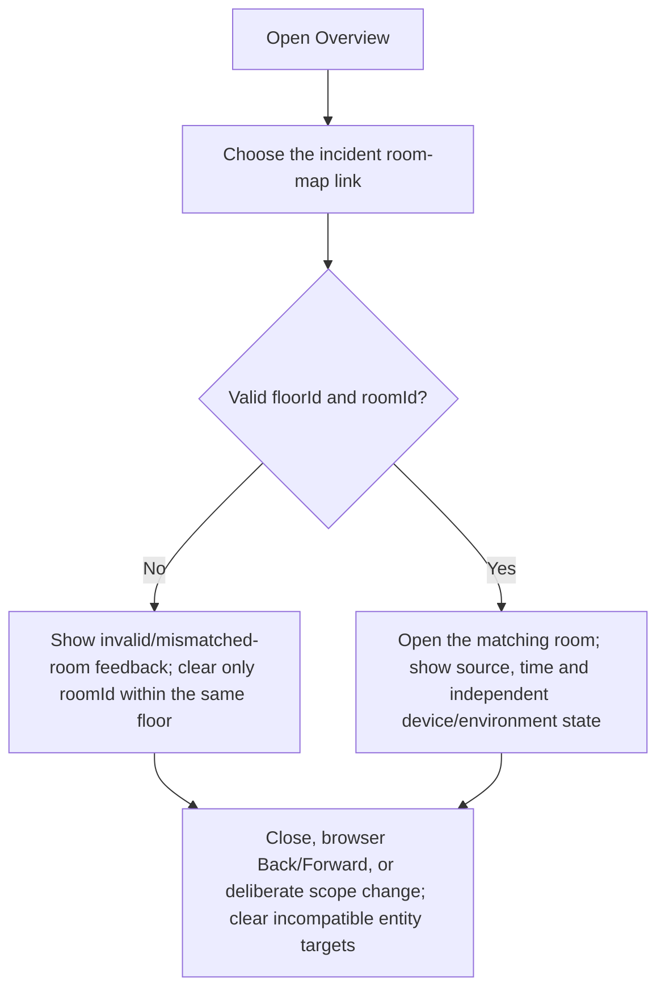

**Evidence / assumptions / unverified behavior:** Current source and non-mutating browser room navigation; not every history/focus permutation tested.

**Recovery:** The No branch explains the invalid, unavailable or disallowed condition. The final node describes continuing the same investigation safely. It does not assert an error automatically opens a different room or grants a new permission.

### Figma-F02 — Date and data applicability

**Purpose:** Date and data applicability. **Entry:** Overview calendar and available source/date fixtures.

**Figma:** [Figma-F02](https://www.figma.com/design/uXR8OCbVLsUSUpYAf7rggD?node-id=16-810). **Screens:** [OV-01 current building](https://www.figma.com/design/uXR8OCbVLsUSUpYAf7rggD?node-id=7-39), [OV-02 current Floor 1](https://www.figma.com/design/uXR8OCbVLsUSUpYAf7rggD?node-id=7-221), [OV-03 current Floor 2](https://www.figma.com/design/uXR8OCbVLsUSUpYAf7rggD?node-id=7-497), [OV-04 room detail](https://www.figma.com/design/uXR8OCbVLsUSUpYAf7rggD?node-id=13-946); date study [calendar](https://www.figma.com/design/uXR8OCbVLsUSUpYAf7rggD?node-id=13-1417). **Recommendations:** UX-029 / UX-032 / UX-035.

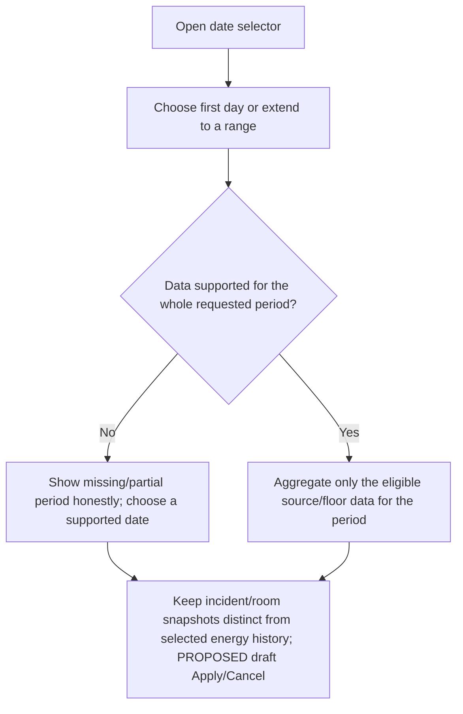

**Evidence / assumptions / unverified behavior:** Current selection applies the first day immediately; Apply/Cancel is proposed, not implemented. No historical telemetry is invented.

**Recovery:** The No branch explains the invalid, unavailable or disallowed condition. The final node describes continuing the same investigation safely. It does not assert an error automatically opens a different room or grants a new permission.

### Figma-F03 — Floor 2 static data and directory recovery

**Purpose:** Floor 2 static data and directory recovery. **Entry:** Choose Floor 2; six areas and 20/22 online in the final observed snapshot.

**Figma:** [Figma-F03](https://www.figma.com/design/uXR8OCbVLsUSUpYAf7rggD?node-id=16-835). **Screens:** [OV-01 current building](https://www.figma.com/design/uXR8OCbVLsUSUpYAf7rggD?node-id=7-39), [OV-02 current Floor 1](https://www.figma.com/design/uXR8OCbVLsUSUpYAf7rggD?node-id=7-221), [OV-03 current Floor 2](https://www.figma.com/design/uXR8OCbVLsUSUpYAf7rggD?node-id=7-497), [OV-04 room detail](https://www.figma.com/design/uXR8OCbVLsUSUpYAf7rggD?node-id=13-946); date study [calendar](https://www.figma.com/design/uXR8OCbVLsUSUpYAf7rggD?node-id=13-1417). **Recommendations:** UX-031 / UX-033 / UX-035.

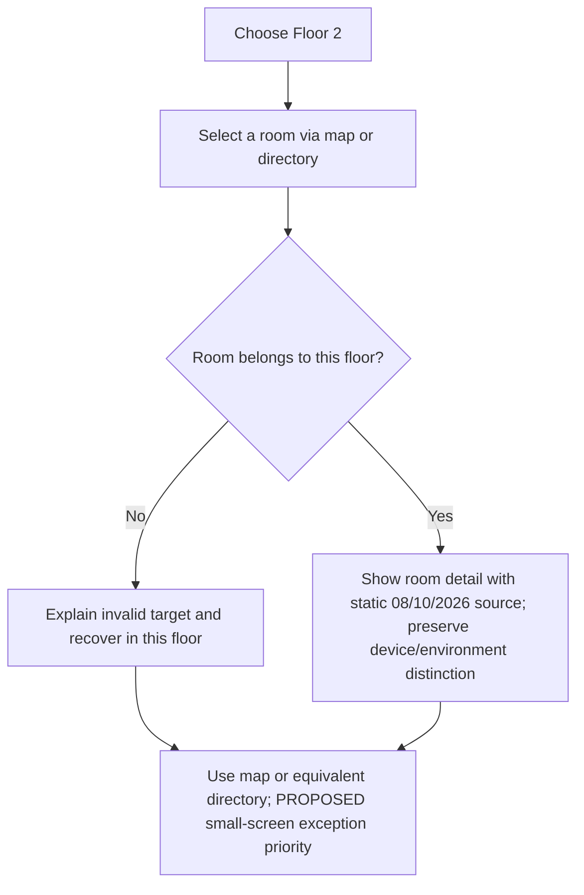

**Evidence / assumptions / unverified behavior:** Room navigation and source labels inspected; camera preview scenes/real streams are not validated. Two source camera markers and schematic FOV are represented.

**Recovery:** The No branch explains the invalid, unavailable or disallowed condition. The final node describes continuing the same investigation safely. It does not assert an error automatically opens a different room or grants a new permission.

### Figma-F04 — Admin / Viewer and incident acknowledgement

**Purpose:** Admin / Viewer and incident acknowledgement. **Entry:** View an unresolved incident in an existing permitted scope.

**Figma:** [Figma-F04](https://www.figma.com/design/uXR8OCbVLsUSUpYAf7rggD?node-id=16-860). **Screens:** [OV-01 current building](https://www.figma.com/design/uXR8OCbVLsUSUpYAf7rggD?node-id=7-39), [OV-02 current Floor 1](https://www.figma.com/design/uXR8OCbVLsUSUpYAf7rggD?node-id=7-221), [OV-03 current Floor 2](https://www.figma.com/design/uXR8OCbVLsUSUpYAf7rggD?node-id=7-497), [OV-04 room detail](https://www.figma.com/design/uXR8OCbVLsUSUpYAf7rggD?node-id=13-946); date study [calendar](https://www.figma.com/design/uXR8OCbVLsUSUpYAf7rggD?node-id=13-1417). **Recommendations:** Historical UX-013 / UX-025 plus UX-029 / UX-035.

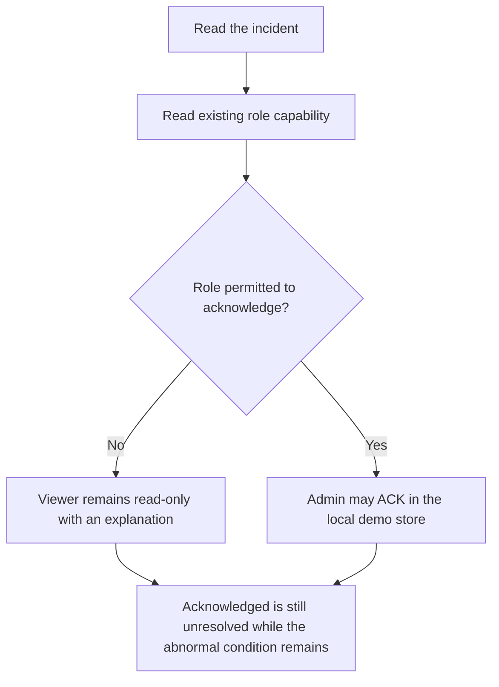

**Evidence / assumptions / unverified behavior:** Source-verified permission path only; no acknowledgement, role change, device command or reset was executed. Frontend permissions do not prove backend authorization.

**Recovery:** The No branch explains the invalid, unavailable or disallowed condition. The final node describes continuing the same investigation safely. It does not assert an error automatically opens a different room or grants a new permission.

### Handoff boundaries

- Current-state Figma frames reconstruct observed/source-derived structure; proposed frames are explicitly labeled PROPOSED — NOT IMPLEMENTED. Diagrams are editable action/state/vector nodes with explicit decisions, not a running prototype.
- The existing mobile navigation focus/Escape and room drawer focus code is retained as source evidence. A rendered design does not certify accessibility or keyboard behavior.
- Date-filter effects are scoped to supported energy aggregation. Floor 2 stays dated 08/10/2026; camera fixture metadata does not prove a live stream.
- Full lower-page mobile/tablet parity, every floor-responsive variant, camera-scene overlays, dark-theme screens and backend failure journeys remain outside the delivered reconstruction. They must not be represented as tested or implemented.
- No packages were installed. Mermaid fences/branches and references were structurally checked; full Mermaid rendering remains unverified.
